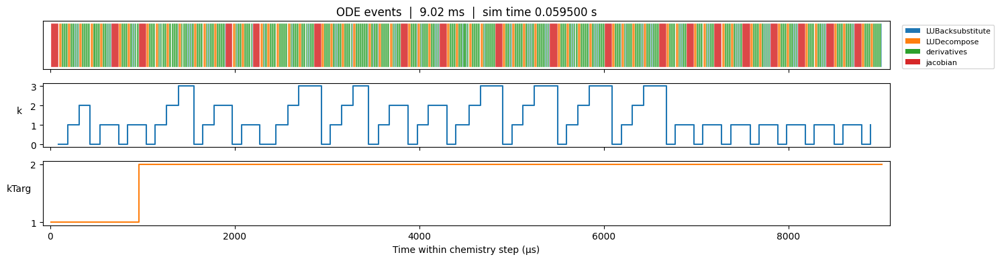

# of_chemistry_performance

Performance and profiling extensions for OpenFOAM chemistry workflows.

## Perfetto Setup

This repository does not vendor Perfetto SDK sources in git.
Install them locally into the repository before building profiled targets.

### 1. Install Perfetto SDK into this repo

```bash
./scripts/install_perfetto.sh
```

Optional version argument:

```bash
./scripts/install_perfetto.sh 54.0
```

### 2. Verify installation

```bash
./scripts/check_perfetto.sh
```

## Build (Profiled Targets)

```bash
./Allwmake
```

## Clean (Profiled Targets)

With the OpenFOAM environment sourced, clean the ODE library and application
build artifacts for the active build configuration:

```bash
./Allclean
```

## Run Example

```bash
cd $WM_PROJECT_USER_DIR/libs/of_chemistry_performance/tests/h2_profiled
FOAM_PERFETTO=1 $FOAM_USER_APPBIN/chemFoam_profiled > log.chemFoam_profiled 2>&1
```

Expected output trace file:

- `chemFoam.perfetto-trace`

## Post-processing

See test/postprocessing.ipynb and [perfetto documentation](https://perfetto.dev/docs/analysis/perfetto-sql-getting-started)

Example of a Figure you can get:


## Notes

- Perfetto include path is repository-local via target-local relative paths to `third_party/perfetto/sdk`.
- `perfetto.cc` is included in exactly one translation unit: `src/ODE/perfetto_sdk.C`.
- Shared trace categories are defined in `tools/perfetto/foam_tracing_categories.H` and copied by the installer.

## Contributors

- Ilya Morev 
- Hasan Celik